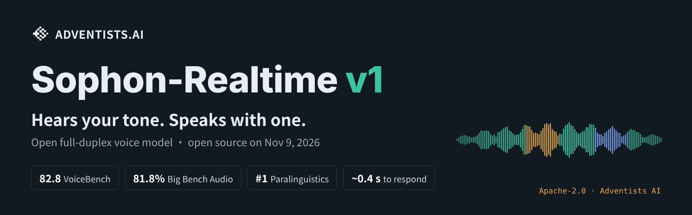
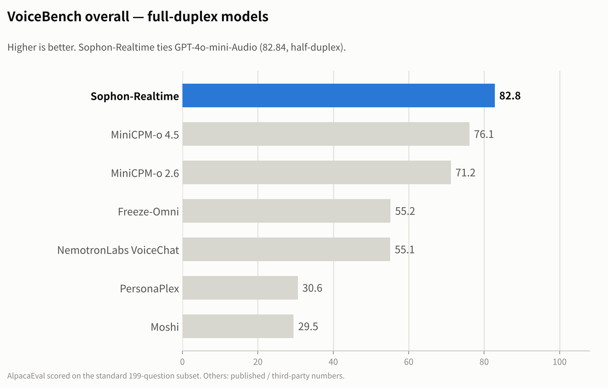
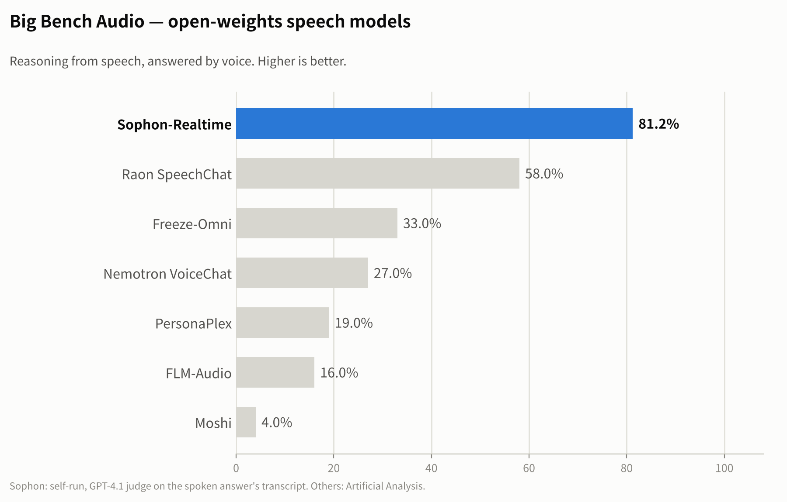
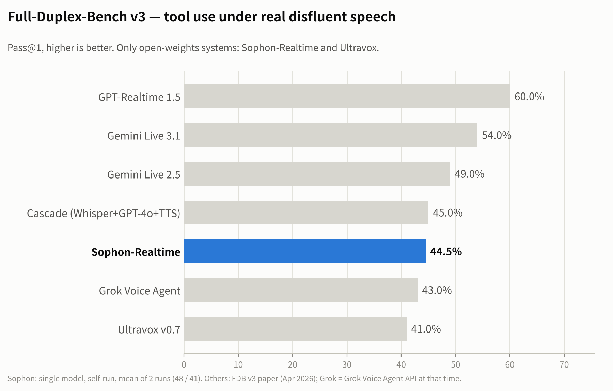
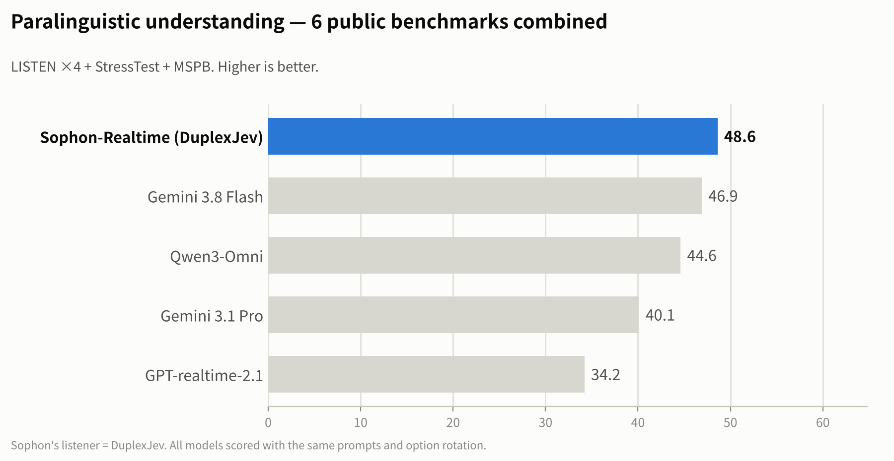
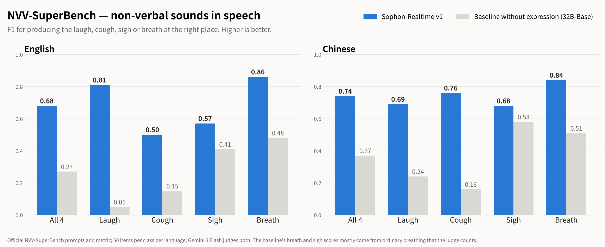

  

  <b>English</b> &nbsp;|&nbsp; <a href="README_CN.md">中文</a>

<h1 align="center">Hears your tone. Speaks with one.</h1>

  <b>Sophon-Realtime v1 is an open full-duplex voice model: it listens while you talk, hears <i>how</i> you say things, and answers with a voice that carries tone of its own.</b>

  
  

  
  
  

> **🚀 Coming soon.** Weights, code and docs go live on **November 9, 2026 at 10:00 Beijing time** (13:00 Melbourne · Nov 8, 18:00 San Francisco).
> ⭐ **Star** this repo, or **Watch → Custom → Releases**, to be notified the moment it's out.

## Highlights

- **VoiceBench 82.8 and Big Bench Audio 81.8%: the strongest brain among open full-duplex models.** #1 among open full-duplex models on both; level with GPT-4o-mini-Audio on VoiceBench.
- **Paralinguistic understanding 48.6, #1 overall: it hears your tone.** Ahead of Gemini 3.8 Flash (46.9) and Qwen3-Omni (44.6) on LISTEN, StressTest and MSPB. It hears emotion, emphasis, sarcasm, laughter and sighs straight from your voice. Its ears are [DuplexJev](https://github.com/adventists-ai/duplexjev), our open speech-decision model.
- **NVV-SuperBench 0.74 (Chinese) and 0.68 (English): it speaks with tone.** The baseline without expression scores 0.37 / 0.27. The model decides from the conversation when to laugh, when to sigh, and when to clear a dry throat.
- **Starts talking about 0.4 s after you stop: it's fast.** It listens the whole time you talk and drafts its reply as you go. When you cut in, it stops and answers your new question.
- **Full-Duplex-Bench v3 tool calling: Pass@1 48%, ahead of Grok (43%), with a 100% response rate: it gets work done.** Live mode lets it work together with a larger backend model, and it is compatible with the OpenAI GPT-Live interface format. Every reply comes with an auditable transcript.
- **Runs on a single GPU: yours to deploy.** A quantized build runs on a single consumer GPU. Apache-2.0 code and weights, free for commercial use.

  
  

  
  

  

Self-run unless noted. VoiceBench: official evaluators with a gpt-4o-mini judge; AlpacaEval on the standard 199-question subset. Big Bench Audio: GPT-4.1 judges the transcript of the spoken answer; other models from Artificial Analysis. Full-Duplex-Bench v3: best of several runs; other systems from the FDB v3 paper (Apr 2026). Paralinguistic understanding: same prompts and option rotation for every model. NVV-SuperBench: official prompts and metric, 50 items per class per language, Gemini 3 Flash judge.

## How it works

- **A vector language hidden inside the model.** We found that the stream of continuous vectors a speech LLM builds while it listens is a complete language in its own right. A frozen LLM reads it as easily as text, and it carries both what was said and how it was said: intonation, emphasis and emotion. Sophon-Realtime v1's voice writes this vector language directly, then turns it back into sound. Hearing and speaking share one representation, so the tone the model can hear is the tone it can speak.
- **Listens continuously.** At each pause, the same model decides in a single token whether you've finished, are still talking, are back-channeling or are thinking.
- **Drafts early, speaks on time.** A reply is drafted from your first pause and released the moment the model decides it's its turn. If you keep talking, the draft is dropped before you hear it.
- **Remembers what you actually heard.** History keeps the real audio of both sides. When you interrupt, only the part you heard is kept.

## Arriving on November 9

- 🧠 Open weights for **Sophon-Realtime v1** on Hugging Face and ModelScope
- 📦 `pip install` package: one command to serve on a single GPU
- 🔌 Live mode with a backend model, compatible with the OpenAI GPT-Live interface format
- 🎧 Browser demo: talk to it with your microphone
- 📖 Docs: quick start, deployment, fine-tuning

## From the same team

- **[DuplexJev](https://github.com/adventists-ai/duplexjev)**: one forward pass of a speech LLM answers every decision a voice agent needs (turn end, interruption, emotion, stress), in 92 ms.

## License

[Apache-2.0](LICENSE) for code and weights.

Sophon series · by <a href="https://github.com/adventists-ai">Adventists AI</a>

