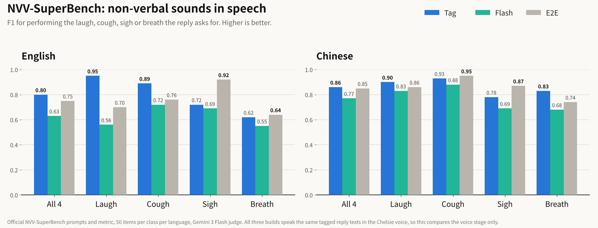

<p align="center">
  
</p>

<p align="center">
  <b>English</b> &nbsp;|&nbsp; <a href="README_CN.md">中文</a>
</p>

<h1 align="center">Hears your tone. Speaks with one.</h1>

<p align="center">
  <b>Sophon-Realtime v1 is an open full-duplex voice model family: it listens while you talk, hears <i>how</i> you say things, and answers with a voice that laughs, sighs and breathes when the moment calls for it.</b>
</p>

<p align="center">
  <a href="https://huggingface.co/adventists-ai/Sophon-Realtime-32B-Tag"></a>
  <a href="https://huggingface.co/adventists-ai/Sophon-Realtime-32B-Flash"></a>
  <a href="https://www.modelscope.cn/models/AdventistsAI/Sophon-Realtime-32B-Tag"></a>
  <a href="https://www.modelscope.cn/models/AdventistsAI/Sophon-Realtime-32B-Flash"></a>
  <a href="https://www.modelscope.ai/studios/AdventistsAI/Sophon-Realtime"></a>
  <a href="LICENSE"></a>
</p>

## Demo

Real conversations with Sophon-Realtime, recorded as they happened: no edits, no speed-up. Turn the sound on.

https://github.com/user-attachments/assets/4d6c74f5-3bbf-4dc2-8b11-f90ff85de4a2

<details>
<summary>Chinese demo</summary>

https://github.com/user-attachments/assets/1d9442ef-84b0-45a3-acd4-2d05a9562397

</details>

## Highlights

- **VoiceBench 82.8 and Big Bench Audio 81.8%: the strongest brain among open full-duplex models.** #1 among open full-duplex models on both; level with GPT-4o-mini-Audio on VoiceBench. All three builds share this brain.
- **Paralinguistic understanding 48.6, #1 overall: it hears your tone.** Ahead of Gemini 3.8 Flash (46.9) and Qwen3-Omni (44.6) on LISTEN, StressTest and MSPB. It hears emotion, emphasis, sarcasm, laughter and sighs straight from your voice. Its ears are [DuplexJev](https://github.com/adventists-ai/duplexjev), our open speech-decision model.
- **NVV-SuperBench 0.86 (Chinese) and 0.80 (English) with the Tag build: it speaks with tone.** The model decides from the conversation when to laugh, sigh, breathe or clear its throat, and the voice performs it instead of reading the tag aloud.
- **Speaks your language: Chinese, English and five European languages, with more on the way.** Italian, German, Spanish, French and Portuguese work out of the box, Japanese and Russian run on Flash, and Korean is next. See [Languages](#languages).
- **Fast: first audio in 0.31 s with Flash.** It listens the whole time you talk and drafts its reply as you go. When you cut in, it stops and answers your new question.
- **Full-Duplex-Bench v3 tool calling: Pass@1 48%, ahead of Grok (43%), with a 100% response rate: it gets work done.** [Live mode](live/README.md) lets it work together with a larger backend model, and it is compatible with the OpenAI GPT-Live interface format. Every reply comes with an auditable transcript.
- **One 80 GB GPU, one command (Tag and Flash).** Served by vLLM-Omni; up to 16 (Tag) or 40 (Flash) concurrent users per GPU. Apache-2.0 code and weights, free for commercial use.

<p align="center">
  
  
</p>
<p align="center">
  
  
</p>
<p align="center">
  
</p>

<sub>Self-run unless noted. VoiceBench: official evaluators with a gpt-4o-mini judge; AlpacaEval on the standard 199-question subset. Big Bench Audio: GPT-4.1 judges the transcript of the spoken answer; other models from Artificial Analysis. Full-Duplex-Bench v3: best of several runs; other systems from the FDB v3 paper (Apr 2026). Paralinguistic understanding: same prompts and option rotation for every model. NVV-SuperBench: official prompts and metric, 50 items per class per language, Gemini 3 Flash judge; the three builds speak the same tagged reply texts in the Chelsie voice. Latency and concurrency: one H100 80 GB, users arriving within 10 s.</sub>

## News

- **2026-11-11 · v1.1: zero-shot voice cloning** in the Tag and Flash builds. A few seconds of audio and it talks to you in that voice, in real time. [Watch the demo](#zero-shot-voice-cloning-new-in-v11)
- **2026-11-11 · 1.1.2:** `sophon-realtime serve` turns on CUDA MPS by default; long-reply and cold-start fixes. See the [changelog](CHANGELOG.md).
- **2026-11-08 · v1.0:** first public release of the Tag, Flash and E2E (preview) builds.

## Three builds, one brain

All three builds share the same brain: one 32B model that listens to your voice, decides when you have finished, and writes the reply. They differ only in **how the reply becomes sound**.

| | **Tag** (recommended) | **Flash** | **E2E** (preview) |
|---|---|---|---|
| How it speaks | The brain writes the reply with sound tags (`[laughter]`, `[sigh]`, `<strong>…</strong>` …); an expressive speech model performs them | Same tagged reply, spoken by a lighter, faster speech model (one forward pass per 80 ms frame) | No separate speech model: a talker inside the 32B model turns the reply into continuous voice vectors, and a decoder turns them into sound |
| Best for | Expressive voice: companions, characters, demos | Speed and scale: customer service, in-car, many users per GPU | Research on end-to-end expressive speech |
| Non-verbal sounds (NVV-SuperBench, en / zh) | **0.80 / 0.86** | 0.63 / 0.77 | 0.60 / 0.77 |
| First audio, one user | ~0.6 s | **0.31 s** | ~1 s |
| Users per 80 GB GPU (recommended) | 16 | **40** | 4–5 (speaking engine) |
| Zero-shot voice cloning | **yes**, from a 3–10 s clip ([how](tag/README.md#zero-shot-voice-cloning)) | **yes**, from a 3–10 s clip ([how](flash/README.md#zero-shot-voice-cloning)) | not yet |
| GPUs | **1** × 80 GB | **1** × 80 GB | 2 × 80 GB |
| Serving | vLLM-Omni, one command | vLLM-Omni, one command | own engine |
| Weights | [HF](https://huggingface.co/adventists-ai/Sophon-Realtime-32B-Tag) · [ModelScope](https://www.modelscope.cn/models/AdventistsAI/Sophon-Realtime-32B-Tag) | [HF](https://huggingface.co/adventists-ai/Sophon-Realtime-32B-Flash) · [ModelScope](https://www.modelscope.cn/models/AdventistsAI/Sophon-Realtime-32B-Flash) | [HF](https://huggingface.co/adventists-ai/Sophon-Realtime-32B-E2E) · [ModelScope](https://www.modelscope.cn/models/AdventistsAI/Sophon-Realtime-32B-E2E) |
| Code | [`tag/`](tag/README.md) | [`flash/`](flash/README.md) | [`docs/deploy.md`](docs/deploy.md) |

**Which one?** Start with **Tag** if you want the voice to act. Pick **Flash** if latency and the number of users per GPU matter most. Same APIs, so you can switch later.

## Languages

Talk to it in your own language. Sophon-Realtime listens and answers in the language you speak.

| Language | Status |
|---|---|
| Chinese, English | Fully supported |
| Italian, German, Spanish, French, Portuguese | Ready for conversation: clear speech, 80–92% of basic questions answered correctly, multi-turn quality close to English |
| Japanese, Russian | Available on the Flash build |
| Korean and more | Coming soon |

<sub>Internal tests, November 2026: 15 languages × 20 spoken questions, plus multi-turn dialogues from Omnilingua-AudioMC in 8 languages (Portuguese not included). Japanese is a priority language for us, and upcoming releases will keep improving it.</sub>

## How it works

- **Listens continuously.** At each pause, the same model decides in a single token whether you've finished, are still talking, are back-channeling or are thinking.
- **Drafts early, speaks on time.** A reply is drafted from your first pause and released the moment the model decides it's its turn. If you keep talking, the draft is dropped before you hear it.
- **Writes how to say it, not just what.** The brain marks where to laugh, sigh, breathe, cough or stress a word. Tag and Flash perform these marks; they are never read aloud.
- **Barge-in.** When you interrupt, it stops and keeps only the part you actually heard in the conversation history.

## Quick start

**Quickest** (Tag build, one 80 GB GPU):

```bash
pip install "sophon-realtime[trt]"   # Python 3.12, Linux, CUDA 13; installs vLLM-Omni, the Tag plugin and TensorRT
sophon-realtime serve           # downloads Sophon-Realtime-32B-Tag (~42 GB) on first run, then serves on port 8000
```

> **Keep the `[trt]`.** Without TensorRT the voice runs in plain PyTorch and is about 3× slower under load (16 users: first audio ~2.4 s
> instead of ~0.75 s, with 1–1.5 s of stutter). `sophon-realtime serve` now warns at start-up when TensorRT is missing.

Or use the one-command scripts, which set up an isolated environment:

**Tag** (one 80 GB GPU):

```bash
git clone https://github.com/adventists-ai/sophon-realtime && cd sophon-realtime/tag
bash install.sh                 # venv + vLLM-Omni + plugin, downloads the weights (~45 GB)
GPU=0 PORT=8000 bash start.sh
python client_example.py --wav my_question.wav --lang en
```

**Flash** (one 80 GB GPU):

```bash
cd sophon-realtime/flash
bash install.sh
modelscope download --model AdventistsAI/Sophon-Realtime-32B-Flash --local_dir ./model   # or: hf download adventists-ai/Sophon-Realtime-32B-Flash --local-dir ./model
GPU=0 PORT=8000 bash start.sh
python client_example.py --wav my_question.wav --lang en --voice chelsie
```

Both serve `ws://HOST:PORT/v1/realtime` (full duplex, OpenAI-Realtime-style) and `POST /v1/chat/completions` (audio in, text + audio out). Details: [tag/README.md](tag/README.md) · [flash/README.md](flash/README.md).

**Optional: Live mode** (OpenAI GPT-Live compatible, see [live/](live/README.md)), next to a running engine:

```bash
cd sophon-realtime/live && BUILD=tag PORT=8000 LIVE_PORT=8780 bash start_live.sh   # GPT-Live clients: ws://HOST:8780/v1/live/sessions
```

## Live mode (OpenAI GPT-Live compatible)

[`live/`](live/README.md) is a gateway that speaks the OpenAI GPT-Live protocol in front of a Tag or Flash engine: GPT-Live clients switch by changing the URL and key. Sophon keeps the voice and hands lookups and actions to your backend through delegation, then speaks the result. Optionally, a larger model can run the back office.

## Zero-shot voice cloning (new in v1.1)

Give Sophon a few seconds of someone's voice and it talks to you in that voice, in real time. No fine-tuning, no restart, one GPU. Works in the Tag and Flash builds.

https://github.com/user-attachments/assets/7f0627b0-fae4-4633-b412-88cb24942ab8

```bash
pip install -U "sophon-realtime[trt]"
sophon-realtime download --source modelscope   # or Hugging Face (default)
cp alice.wav model/voices/                      # 3-10 s, one speaker
sophon-realtime serve                           # then set "voice": "alice"
```

New, replaced and deleted voices take effect on the next request. Barge-in, backchannels and laughs still work in a cloned voice, and a voice cloned from one language can speak another. Everything stays on your server ([details](tag/README.md#zero-shot-voice-cloning)). The video also shows [Live mode](live/README.md): Sophon hands lookups (weather, news) to your own backend, keeps talking, then says the answer.

**Please only clone your own voice or voices you have permission to use. Do not use it to impersonate anyone or to deceive.**

<details>
<summary>Chinese-subtitled version</summary>

https://github.com/user-attachments/assets/74bd6096-b6fc-4433-a1d7-d3e967107193

</details>

## E2E (preview)

The E2E build speaks without a separate speech model. While the 32B model listens, it builds a stream of continuous vectors that carries both what was said and how; the E2E talker writes replies in that same vector language and a decoder turns it into sound, so hearing and speaking share one representation. It runs on two 80 GB GPUs with our own engine ([docs/deploy.md](docs/deploy.md)). Weights: [HF](https://huggingface.co/adventists-ai/Sophon-Realtime-32B-E2E) · [ModelScope](https://www.modelscope.cn/models/AdventistsAI/Sophon-Realtime-32B-E2E).

**New build (Nov 2026): upgraded decoder, 4 steps.** Same compute per audio chunk as before. On replies from the same talker:

| | previous decoder | new decoder |
|---|---|---|
| Long replies, error rate (150 replies, zh / en / ja) | 1.78% (1.03 / 1.32 / 2.99) | **1.51% (0.97 / 0.71 / 2.86)** |
| Voice similarity to an unseen reference speaker | 0.33 | **0.52** |

The previous weights stay in [Sophon-Realtime-v1](https://huggingface.co/adventists-ai/Sophon-Realtime-v1).

## Fine-tuning

Adapt the brain (persona, tone, domain knowledge, tool use) with LoRA in [ms-swift](https://github.com/modelscope/ms-swift) on one 80 GB GPU. The voice, expressive sound tags and turn-taking are kept. See [finetune/](finetune/README.md).

## From the same team

- **[DuplexJev](https://github.com/adventists-ai/duplexjev)**: one forward pass of a speech LLM answers every decision a voice agent needs (turn end, interruption, emotion, stress), in 92 ms.

## License

[Apache-2.0](LICENSE) for code and weights. See each build's `NOTICE` for third-party components.

<p align="center"><sub>Sophon series · by <a href="https://github.com/adventists-ai">Adventists AI</a></sub></p>
