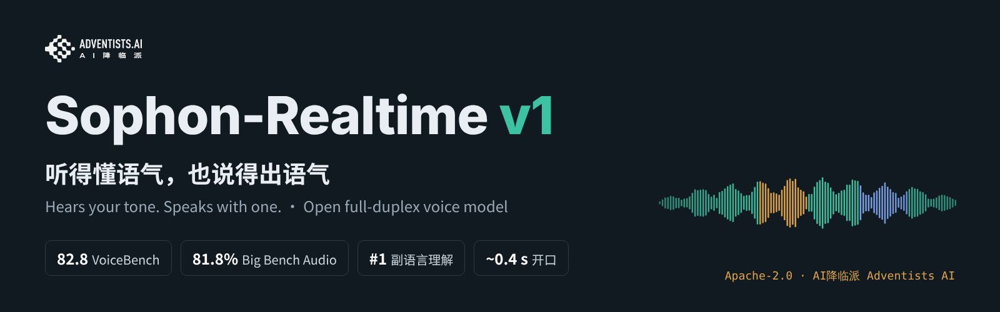
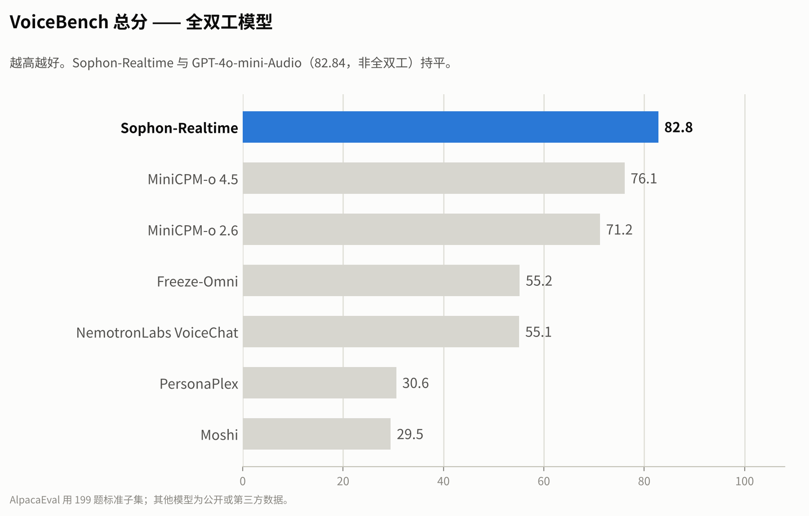
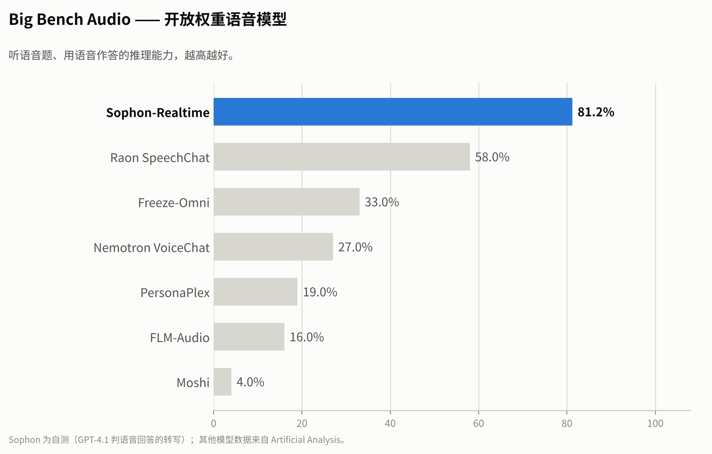
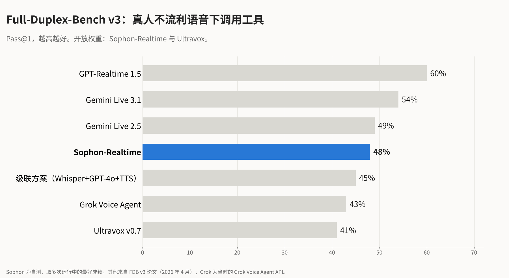
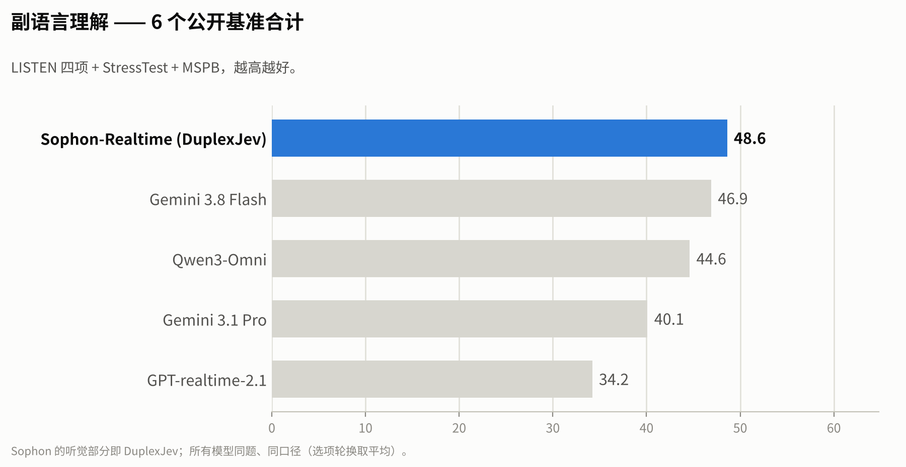
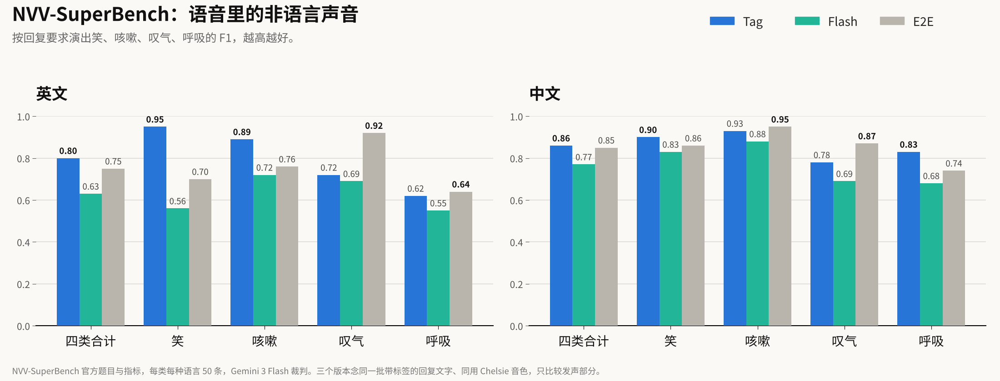

<p align="center">
  
</p>

<p align="center">
  <a href="README.md">English</a> &nbsp;|&nbsp; <b>中文</b>
</p>

<h1 align="center">听得懂语气，也说得出语气</h1>

<p align="center">
  <b>智子实时语音 Sophon-Realtime v1 是一个开源全双工语音模型系列：你说话时它一直在听，听得出你<i>怎么</i>说；回答时，该笑就笑，该叹气就叹气，该换气就换气。</b>
</p>

<p align="center">
  <a href="https://www.modelscope.cn/models/AdventistsAI/Sophon-Realtime-32B-Tag"></a>
  <a href="https://www.modelscope.cn/models/AdventistsAI/Sophon-Realtime-32B-Flash"></a>
  <a href="https://huggingface.co/adventists-ai/Sophon-Realtime-32B-Tag"></a>
  <a href="https://huggingface.co/adventists-ai/Sophon-Realtime-32B-Flash"></a>
  <a href="https://www.modelscope.cn/studios/AdventistsAI/Sophon-Realtime"></a>
  <a href="LICENSE"></a>
</p>

## 演示

和智子实时语音的真实对话录屏，未剪辑、未加速。记得打开声音。

https://github.com/user-attachments/assets/1d9442ef-84b0-45a3-acd4-2d05a9562397

<details>
<summary>英文演示</summary>

https://github.com/user-attachments/assets/4d6c74f5-3bbf-4dc2-8b11-f90ff85de4a2

</details>

## 亮点

- **VoiceBench 82.8、Big Bench Audio 81.8%：开源全双工里最强的「大脑」。** 两项都是开源全双工模型第一，VoiceBench 与 GPT-4o-mini-Audio 持平。三个版本共用这个大脑。
- **副语言理解 48.6，综合第一：听得懂语气。** 在 LISTEN、StressTest、MSPB 公开基准上高于 Gemini 3.8 Flash（46.9）和 Qwen3-Omni（44.6）。它直接从声音里听出情绪、重音、反讽、笑声和叹气。它的耳朵是我们开源的语音决策模型 [DuplexJev](https://github.com/adventists-ai/duplexjev/blob/main/README_CN.md)。
- **NVV-SuperBench：Tag 版中文 0.86、英文 0.80，说得出语气。** 什么时候笑、叹气、换气、清嗓子，由模型根据对话自己决定；声音把这些标记演出来，不会把标签念出来。
- **快：Flash 版首包 0.31 秒。** 你说话的全程它都在听，回复边听边起草；你插话，它马上停下，回答你的新问题。
- **Full-Duplex-Bench v3 工具调用 Pass@1 48%，高于 Grok（43%）；接话成功率 100%：能干活。** 支持 [Live 模式](live/README_CN.md)，可以和后端大模型联合工作；兼容 OpenAI GPT-Live 的接口格式。每句回答都有文字记录，可以审计。
- **一张 80 GB 显卡、一条命令（Tag 和 Flash）。** 基于 vLLM-Omni 部署，单卡建议并发 Tag 16 路、Flash 40 路。代码和权重都是 Apache-2.0，可以商用。

<p align="center">
  
  
</p>
<p align="center">
  
  
</p>
<p align="center">
  
</p>

<sub>除注明外均为自测。VoiceBench：官方评测脚本，gpt-4o-mini 裁判；AlpacaEval 用标准 199 题子集。Big Bench Audio：GPT-4.1 对语音回答的转写打分，其他模型数据来自 Artificial Analysis。Full-Duplex-Bench v3：多次运行取最好，其他系统数据来自 FDB v3 论文（2026 年 4 月）。副语言理解：所有模型同样的提示词和选项轮换。NVV-SuperBench：官方题目与指标，每类每种语言 50 条，Gemini 3 Flash 裁判；三个版本念同一批带标签的回复文字，同用 Chelsie 音色。延迟和并发：单张 H100 80 GB，用户在 10 秒内陆续接入。</sub>

## 三个版本，同一个大脑

三个版本的大脑完全相同：同一个 32B 模型负责听你说话、判断你说完没有、写出回复。区别只在于**回复怎么变成声音**。

| | **Tag**（推荐） | **Flash** | **E2E**（预览） |
|---|---|---|---|
| 怎么出声 | 大脑写出带声音标签的回复（`[laughter]`、`[sigh]`、`<strong>…</strong>` 等），由一个擅长表演的语音模型演出来 | 同样是带标签的回复，交给更轻、更快的语音模型来说（每 80 ms 一帧，一次前向） | 不用单独的语音模型：32B 模型内部的说话头把回复直接变成连续的声音向量，再由解码器还原成声音 |
| 适合 | 表现力优先：陪伴、角色、演示 | 速度和并发优先：客服、车机、一张卡服务很多人 | 端到端表达的研究 |
| 非语言声音（NVV-SuperBench，英 / 中） | **0.80 / 0.86** | 0.63 / 0.77 | 0.60 / 0.77 |
| 单路首包 | 约 0.6 s | **0.31 s** | 约 1 s |
| 每张 80 GB 卡建议并发 | 16 路 | **40 路** | 4–5 路（说话引擎） |
| 显卡 | **1** × 80 GB | **1** × 80 GB | 2 × 80 GB |
| 部署 | vLLM-Omni，一条命令 | vLLM-Omni，一条命令 | 自研引擎 |
| 权重 | [魔搭](https://www.modelscope.cn/models/AdventistsAI/Sophon-Realtime-32B-Tag) · [HF](https://huggingface.co/adventists-ai/Sophon-Realtime-32B-Tag) | [魔搭](https://www.modelscope.cn/models/AdventistsAI/Sophon-Realtime-32B-Flash) · [HF](https://huggingface.co/adventists-ai/Sophon-Realtime-32B-Flash) | [魔搭](https://www.modelscope.cn/models/AdventistsAI/Sophon-Realtime-32B-E2E) · [HF](https://huggingface.co/adventists-ai/Sophon-Realtime-32B-E2E) |
| 代码 | [`tag/`](tag/README_CN.md) | [`flash/`](flash/README_CN.md) | [`docs/deploy_CN.md`](docs/deploy_CN.md) |

**怎么选？** 想让声音"会演"，先用 **Tag**；最看重延迟和单卡能接多少人，用 **Flash**。两者接口相同，之后可以随时切换。

## 工作方式

- **一直在听。** 每次你停顿，同一个模型用一个 token 判断：你说完了、还在说、只是附和，还是在想。
- **提前起草，按时开口。** 你第一次停顿时它就开始起草，判定轮到自己时立刻说出来；如果你接着说，草稿在你听到之前就丢掉。
- **不只写说什么，还写怎么说。** 大脑会标出哪里该笑、叹气、换气、咳嗽、加重语气；Tag 和 Flash 把这些标记演出来，不会念出来。
- **可以随时打断。** 你一插话它就停下，对话历史里只保留你真正听到的那部分。

## 快速上手

**最快**（Tag 版，一张 80 GB 显卡）：

```bash
pip install sophon-realtime     # Python 3.12、Linux、CUDA；会装好 vLLM-Omni 和 Tag 插件
sophon-realtime serve           # 首次运行自动下载 Sophon-Realtime-32B-Tag（约 42 GB），然后在 8000 端口提供服务
```

也可以用一键脚本，会建一个独立的虚拟环境：

**Tag**（一张 80 GB 显卡）：

```bash
git clone https://github.com/adventists-ai/sophon-realtime && cd sophon-realtime/tag
bash install.sh                 # 建环境、装 vLLM-Omni 和插件、下载权重（约 45 GB）
GPU=0 PORT=8000 bash start.sh
python client_example.py --wav my_question.wav --lang zh
```

**Flash**（一张 80 GB 显卡）：

```bash
cd sophon-realtime/flash
bash install.sh
modelscope download --model AdventistsAI/Sophon-Realtime-32B-Flash --local_dir ./model
GPU=0 PORT=8000 bash start.sh
python client_example.py --wav my_question.wav --lang zh --voice chelsie
```

两者都提供 `ws://HOST:PORT/v1/realtime`（全双工，OpenAI Realtime 风格）和 `POST /v1/chat/completions`（语音进，文字 + 语音出）。详见 [tag/README_CN.md](tag/README_CN.md) · [flash/README_CN.md](flash/README_CN.md)。

**可选：开启 Live 模式**（兼容 OpenAI GPT-Live，见 [live/](live/README_CN.md)），在已启动的引擎旁边运行：

```bash
cd sophon-realtime/live && BUILD=tag PORT=8000 LIVE_PORT=8780 bash start_live.sh   # GPT-Live 客户端连 ws://HOST:8780/v1/live/sessions
```

## Live 模式（兼容 OpenAI GPT-Live）

[`live/`](live/README_CN.md) 是一个网关：对外是 OpenAI GPT-Live 协议，后面接 Tag 或 Flash 引擎；GPT-Live 客户端只要换地址和 key 就能用。智子负责听和说，需要查询、办事时通过委派交给你的后端，再把结果说出来；也可以让一个更大的模型做后台。

## E2E（预览）

E2E 版不用单独的语音模型。32B 模型在听的时候会形成一串连续向量，里面既有说了什么，也有怎么说的；E2E 的说话头用同一种向量语言写出回复，再由解码器还原成声音，听和说用的是同一种表示。它需要两张 80 GB 显卡、使用我们的自研引擎（[docs/deploy_CN.md](docs/deploy_CN.md)）。权重：[魔搭](https://www.modelscope.cn/models/AdventistsAI/Sophon-Realtime-32B-E2E) · [HF](https://huggingface.co/adventists-ai/Sophon-Realtime-32B-E2E)。

**新版（2026-11）：解码器换代，4 步出声。** 每块音频的计算量与旧版相同。同一说话头的回复上：

| | 旧解码器 | 新解码器 |
|---|---|---|
| 长回复错字率（150 条，中 / 英 / 日） | 1.78%（1.03 / 1.32 / 2.99） | **1.51%（0.97 / 0.71 / 2.86）** |
| 未见说话人参考音色的相似度 | 0.33 | **0.52** |

旧版权重仍保留在 [Sophon-Realtime-v1](https://www.modelscope.cn/models/AdventistsAI/Sophon-Realtime-v1)。

## 微调

可以在一张 80 GB 显卡上用 [ms-swift](https://github.com/modelscope/ms-swift) 以 LoRA 方式调整大脑（人设、语气、领域知识、工具调用），声音、声音标签和接话能力都会保留。详见 [finetune/](finetune/README_CN.md)。

## 同一团队的其他项目

- **[DuplexJev](https://github.com/adventists-ai/duplexjev/blob/main/README_CN.md)**：语音大模型一次前向，回答语音智能体需要的所有判断（说完没、打断、情绪、重音），只要 92 毫秒。

## 许可

代码和权重均为 [Apache-2.0](LICENSE)。第三方组件见各版本目录下的 `NOTICE`。

<p align="center"><sub>智子系列 · <a href="https://github.com/adventists-ai">AI 降临派 Adventists AI</a></sub></p>
