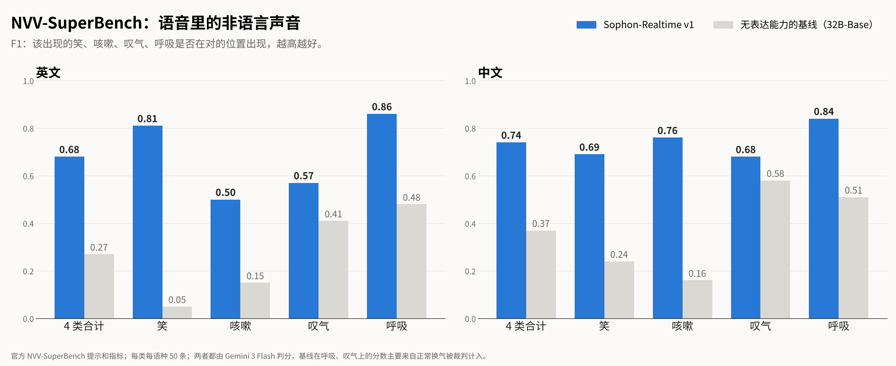

  

  <a href="README.md">English</a> &nbsp;|&nbsp; <b>中文</b>

<h1 align="center">听得懂语气，也说得出语气</h1>

  <b>Sophon-Realtime v1 是一个开源的全双工语音模型：你说话时它一直在听，听得出你<i>怎么</i>说；回答时，声音里也带着语气。</b>

  
  

  
  
  

> **🚀 即将开源。** 权重、代码和文档将于 **2026 年 11 月 9 日北京时间上午 10:00** 公开。
> ⭐ 点 **Star**，或者 **Watch → Custom → Releases**，发布时第一时间收到通知。

## 亮点

- **VoiceBench 82.8、Big Bench Audio 81.8%：开源全双工里最强的「脑子」。** 两项都是开源全双工模型第一，VoiceBench 与 GPT-4o-mini-Audio 持平。
- **副语言理解 48.6，综合第一：听得懂语气。** 在 LISTEN、StressTest、MSPB 公开基准上高于 Gemini 3.8 Flash（46.9）和 Qwen3-Omni（44.6）。它直接从声音里听出情绪、重音、反讽、笑声和叹气。它的耳朵是我们开源的语音决策模型 [DuplexJev](https://github.com/adventists-ai/duplexjev/blob/main/README_CN.md)。
- **NVV-SuperBench 中文 0.74、英文 0.68：说得出语气。** 无表达能力的基线只有 0.37 / 0.27。回答时什么时候笑、什么时候叹气、嗓子干了要不要清一清，由模型根据对话自己决定。
- **约 0.4 秒开口：快。** 你说话的全程它都在听，回复边听边起草；你插话，它马上停下，回答你的新问题。
- **Full-Duplex-Bench v3 工具调用 Pass@1 48%，高于 Grok（43%）；接话成功率 100%：能干活。** 支持 Live 模式，可以和后端大模型联合工作；兼容 OpenAI GPT-Live 的接口格式。每句回答都有文字记录，可以审计。
- **单张显卡即可部署：能自己部署。** 量化版本可在单张消费级显卡上运行。代码和权重都是 Apache-2.0，可以商用。

  
  

  
  

  

未注明的为自测。VoiceBench：官方评测器，gpt-4o-mini 判分；AlpacaEval 用 199 题标准子集。Big Bench Audio：语音回答转写后由 GPT-4.1 判分，其他模型来自 Artificial Analysis。Full-Duplex-Bench v3：取多次运行中的最好成绩，其他系统来自 FDB v3 论文（2026 年 4 月）。副语言理解：所有模型用相同提示和选项轮换。NVV-SuperBench：官方提示和指标，每类每语种 50 条，Gemini 3 Flash 判分。

## 工作原理

- **一门藏在模型里的「向量语言」。** 我们发现，语音大模型在听声音时，内部用的那串连续向量本身就是一门完整的语言：冻结的大模型能像读文字一样直接读懂它，里面既有说了什么，也有怎么说的，包括语调、轻重、情绪。Sophon-Realtime v1 的发声端直接「写」这门向量语言，再把它还原成声音。听和说用的是同一套表示，所以模型听得懂的语气，它也说得出来。
- **一直在听。** 音频持续流入模型。每次停顿，同一个模型用一个 token 判断：你说完了、还在说、在附和，还是在想。
- **提前起草，准时开口。** 第一次停顿就开始起草回复，判断轮到自己时立刻说出来；你如果继续说，草稿在你听到之前就丢掉。
- **记得你真正听到了什么。** 历史里保存双方的真实音频。你打断时，只保留你已经听到的部分。

## 11 月 9 日上线

- 🧠 **Sophon-Realtime v1** 开放权重（Hugging Face、魔搭）
- 📦 `pip install` 一行安装，单张显卡一条命令启动服务
- 🔌 Live 模式接后端大模型，兼容 OpenAI GPT-Live 接口格式
- 🎧 网页 Demo：打开麦克风就能对话
- 📖 文档：快速上手、部署、微调

## 同一团队的其他项目

- **[DuplexJev](https://github.com/adventists-ai/duplexjev/blob/main/README_CN.md)**：语音大模型一次前向，回答语音智能体需要的所有判断（说完没有、要不要打断、情绪、重音），92 毫秒。

## 许可证

代码和权重都是 [Apache-2.0](LICENSE)。

Sophon 系列 · <a href="https://github.com/adventists-ai">AI降临派（Adventists AI）</a>

