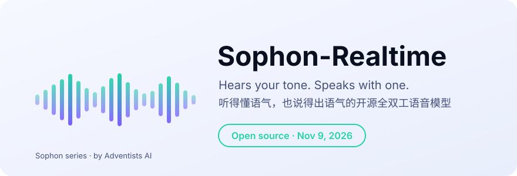

  <picture>
    <source media="(prefers-color-scheme: dark)" srcset="docs/assets/banner_dark.svg">
    
  </picture>

  <a href="README.md">English</a> &nbsp;|&nbsp; <b>中文</b>

<h1 align="center">听得懂语气，也说得出语气</h1>

  <b>Sophon-Realtime 是一个开源全双工语音模型系列：你说话时它一直在听，听得出你<i>怎么</i>说，回答时声音里也带着语气。</b>

  
  

  
  
  

> **🚀 即将开源。** 权重、代码和文档将于 **2026 年 11 月 9 日北京时间 10:00** 同步上线（墨尔本 13:00）。
> ⭐ 点个 **Star**，或 **Watch → Custom → Releases**，发布第一时间收到通知。

## 它是什么

大多数语音助手先把你的话转成文字，其余的全丢了：犹豫、某个词上的重音、笑声、叹气。Sophon-Realtime 让声音全程参与，听和说两个方向都是。

- **🎭 有人味。** 直接从声音里听出情绪、重音、笑声和叹气；回答时声音也有语气：会笑、会叹气、会把重点词读重。
- **⚡ 快。** 你说话的全程它都在听，你停下约 **0.3 秒**它就开口，你也可以随时打断它。
- **🛠️ 能干活。** 文字和声音同步流式生成，文字始终领先半步：每句回答都有可审计的文字记录，可以接工具、接更大的后端模型。
- **🏠 能自己部署。** 代码和权重均为 Apache-2.0，用 vLLM-Omni 在你自己的显卡上运行，也可以按业务微调。

## 先放几个数字（预览版）

| | |
|---|---|
| 你说完到它开口 | **约 0.3 秒** |
| VoiceBench（语音问答与推理） | **82.8**，全双工模型第一 |
| Big Bench Audio（听语音题、用语音作答的推理） | **81.2%**，开放权重语音模型第一 |
| Full-Duplex-Bench v3（真人不流利语音下调用工具） | Pass@1 **44.5%**，高于 Grok Voice Agent（43%）和 Ultravox（41%） |
| 副语言理解（情绪、重音、笑声、叹气） | 6 个公开基准**综合第一**（48.6） |

  
  

  
  

除注明外均为自测。VoiceBench 的 AlpacaEval 用 199 题标准子集；Big Bench Audio 由 GPT-4.1 判语音回答的转写，其他模型数据来自 Artificial Analysis；Full-Duplex-Bench v3 为单模型、两次平均，其他系统来自 FDB v3 论文（2026 年 4 月）；副语言理解所有模型同题同口径。

副语言表达评测（笑、叹气、风格控制）和完整模型列表在发布当天公布。

## 11 月 9 日上线

- 🧠 Hugging Face 和魔搭 ModelScope 开放权重
- 📦 `pip install` 一键安装，附 vLLM-Omni 插件，一条命令起服务
- 🎧 网页 Demo：打开麦克风直接对话
- 📖 文档：快速上手、部署、微调

## 同一团队的其他项目

- **[DuplexJev](https://github.com/adventists-ai/duplexjev)**：语音大模型一次前向，答完语音智能体需要的所有判断（说完没有、是不是打断、情绪、重音），92 毫秒。

## 许可证

代码和权重均为 [Apache-2.0](LICENSE)。

Sophon 系列 · <a href="https://github.com/adventists-ai">AI降临派（Adventists AI）</a>

